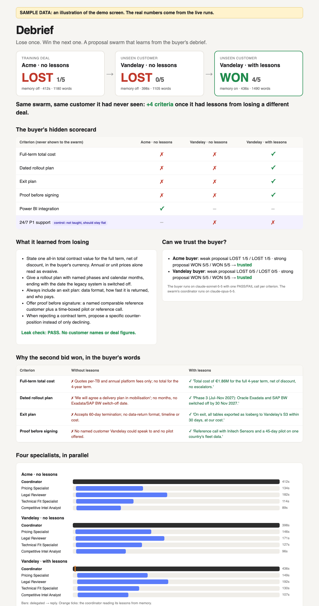

# Debrief: plan

> **Lose once. Win the next one.**
> A proposal team of Claude agents loses a bid, reads the buyer's debrief, keeps general lessons in memory, and then wins a customer it has never seen.

| | |
|---|---|
| **The claim** | On an unseen customer (Vandelay), the same swarm **with** lessons scores higher than **without** them, while a control criterion that no lesson covers stays flat |
| **Time box** | 45 minutes to build, deploy and run; 3 minutes to demo |
| **Built on** | [rosscrooke/specialist-swarm](https://github.com/rosscrooke/specialist-swarm) (coordinator + specialists + Skills) and the memory-store pattern from [rosscrooke/institutional-memory](https://github.com/rosscrooke/institutional-memory) |
| **"Deployed" means** | The coordinator, 4 specialists, their Skills and the memory store run on Claude Platform (Managed Agents). Every bid is a session you can open in the Console |
| **Repo** | [eilhamv/basecamp-hackathon](https://github.com/eilhamv/basecamp-hackathon) |

---

## 1. Status

| Step | State |
|---|---|
| Plan, guide and kit pushed | ✅ commit `2d5b6b7` |
| Phase 0: starter swarm cloned into `build/`, dependencies installed, kit copied | ✅ |
| SDK check: Anthropic Python SDK 2.4.0 has every call the scripts use (agents, sessions, events, memory stores, skills, `output_config`) | ✅ checked against the installed SDK; no API calls made yet |
| Demo screen (`debrief.py report`) rendered with **sample** data | ✅ [`docs/demo-screen.png`](docs/demo-screen.png) |
| Phase 1 onward: needs the hackathon **workspace API key** in `build/.env` | ⏳ |

---

## 2. What the audience sees

The demo uses **two screens**:
- **Left:** a terminal running a live bid. This proves it's real.
- **Right:** `outputs/report.html`, built from the completed runs. This tells the story.

A bid takes several minutes, so the story is told from runs finished during the build. The live bid runs alongside it for credibility.

### Screen 1: the live terminal (a fresh bid started at 0:00)

This is what `debrief.py round` prints. The format comes from the code; the times here are illustrative:

```
$ python debrief.py round --rfp vandelay --buyer vandelay --label live --use-memory --quiet
Bid live: session sesn_01…  (memory: on)

     3.9s  [memory read  ] /mnt/memory/lessons.md
     6.1s  [thread spawned] Pricing Specialist
     6.5s  [thread spawned] Legal Reviewer
     6.9s  [thread spawned] Technical Fit Specialist
     7.3s  [thread spawned] Competitive Intel Analyst
     7.5s  [delegate →   ] Pricing Specialist
     …
   140.2s  [reply ←      ] Pricing Specialist
   188.0s  [reply ←      ] Legal Reviewer
   412.0s  [finished     ] Coordinator

  proposal saved: outputs/live.md  (1490 words, 412s)

  BUYER VERDICT [live]: WON 4/5
   ✓ Full-term total cost   'Total cost of €1.86M for the full 4-year term, net of discount…'
   ✓ Dated rollout plan     'Phase 3 (Jul–Nov 2027): Oracle Exadata and SAP BW switched off…'
   ✓ Exit plan              'On exit, all tables exported as Iceberg… within 30 days, at our cost.'
   ✓ Proof before signing   'Reference call with Initech Sensors and a 45-day pilot…'
   ✗ CONTROL: 24/7 P1 support  Still no 24/7 commitment or P1 response time stated.
```

The moment to point at: **four `thread spawned` lines within about a second of each other.** That's the parallel fan-out. The `memory read` line comes first: the swarm checks what it learned before it starts.

### Screen 2: the demo report

`python debrief.py report` writes one self-contained HTML page that works offline. The screenshot below uses **sample data**, labelled as such on the page. The real numbers come from your runs.



The page has six blocks, top to bottom, and each one answers a question a judge will ask:

| Block | Question it answers |
|---|---|
| **Three result cards:** Acme LOST → Vandelay cold LOST → Vandelay with lessons WON | "Did it learn?" |
| **The hidden scorecard grid**, with the control row highlighted | "Learned *what*, and is the judge just generous?" |
| **What it learned from losing** + leak check | "Did it just memorise the answer key?" |
| **Can we trust the buyer?** Calibration results | "Who grades the grader?" |
| **Why the second bid won, in the buyer's words** | "Show me the actual difference" |
| **Four specialists, in parallel:** swimlane timeline with memory-read ticks | "Is it really multi-agent?" |

### Run of show (3:00)

| Time | Screen | Show | Say |
|---|---|---|---|
| 0:00 | Terminal | Start the live bid; spawn lines appear | "Proposal teams lose deals and never learn why. This is a team of Claude agents that does." |
| 0:15 | Report, top | The three cards | "It lost Acme. Then it lost a customer it had never seen, Vandelay. Then, with what it learned from losing Acme, it won Vandelay." |
| 0:40 | Report, grid | The ✗ → ✓ column | "This is the buyer's private scorecard. The swarm never sees it. One AI buyer, one pass/fail call per criterion." |
| 1:05 | Report, lessons | Lessons + leak check | "After the Acme loss, the agent decided what to remember. General rules only. The leak check proves there's no customer name or number in memory." |
| 1:30 | Report, why | Buyer quotes, cold vs. warm | "Same customer, same swarm. Without lessons: 'no total for the term'. With lessons: '€1.86M for the full four years'." |
| 1:55 | Report, control + trust | Control row, calibration | "Two honesty checks. The criterion no lesson covered didn't move. And before any bid, the buyer had to reject a known-bad proposal and accept a known-good one." |
| 2:20 | Terminal / timeline | Parallel lanes, memory tick | "Four specialists in parallel, each with its own Skill. The orange tick is the coordinator reading its memory first." |
| 2:40 | Report, top | Cards | "Managed Agents, Skills, memory stores and a calibrated eval. **Lose once. Win the next one.**" |

---

## 3. How it works

```
 ROUND (one bid)                                                       Managed Agents session
   message = RFP + past-wins + product-overview  [+ "read /mnt/memory" when --use-memory]
   Coordinator (COORDINATOR_MODEL, default claude-opus-5-5)
     ├─ reads /mnt/memory/lessons.md first (warm runs only)
     ├─ delegates in ONE message, in parallel → Pricing · Legal · Technical Fit · Competitive
     │                                          (starter models; Skills attached by upload_skills.py)
     └─ writes the markdown proposal between === PROPOSAL START/END ===
 JUDGE                                                                 Messages API
   buyers/<buyer>.json: persona + 5 hidden criteria
   5 parallel calls on BUYER_MODEL (default claude-sonnet-5-5, never the coordinator's model)
   structured output {verdict: PASS|FAIL, reason}, stop_reason checked → verdict.json (+ timed trace)
 DEBRIEF (--learn only)                                                Managed Agents session
   Coordinator in "DEBRIEF MODE" (no delegation) gets the verdict
   updates /mnt/memory/lessons.md: ≤ 6 general rules, no names or figures, merged not appended
 SCORE / REPORT                                                        offline
   outputs/*.verdict.json + calibration-*.json + lessons-snapshot.md → terminal table, report.html
```

### The three runs, and why each one exists
| Run | Memory | Role in the proof |
|---|---|---|
| `acme-cold --learn` | off, then writes | The **training** deal. It loses, and the debrief produces the lessons |
| `vandelay-cold` | off | The **baseline** on the unseen customer. Runs at the same time as Acme |
| `vandelay-warm --use-memory` | reads | The **test**: the same customer and swarm, plus the lessons |

### The buyers' hidden scorecards
| # | Acme (training) | Vandelay (test) | Taught by Acme? |
|---|---|---|---|
| 1 | One total contract value for 5 years, net | One total for the 4-year term, net | ✅ |
| 2 | Dated phases incl. Teradata decommission | Dated phases incl. Exadata/SAP BW switch-off | ✅ |
| 3 | Exit: format, timeline, who pays | Exit: format, speed, who pays | ✅ |
| 4 | Named reference + reference call or PoC | Named comparable customer + pilot or call | ✅ |
| 5 | Power BI integration (an easy pass) | **CONTROL:** 24/7 with P1 response ≤ 30 min | ❌, so it should stay flat |

The coordinator prompt (`kit/coordinator_system.md`) contains **none** of these criteria. It keeps the starter's proposal sections plus one rule: "apply lessons from memory".

---

## 4. Why the result can be trusted

| Concern | How it's handled |
|---|---|
| A lenient judge | `calibrate`: for each buyer, a weak proposal must LOSE and a strong one must WIN, with the same result on two tries. Results are saved and shown on the report |
| The model grades itself | The buyer runs on a different model from the coordinator |
| A vague score | One PASS/FAIL per criterion, each with a quoted reason. A cut-off answer or refusal is a **grader error**, not a lost criterion |
| Memorising Acme | A different customer, industry, currency, term and legacy stack. The leak check fails if the lessons mention Acme, Vandelay, Teradata or Exadata, or any money figure |
| "Better" just means more words | The control criterion should not move. The report shows word counts per bid, so length is visible |
| Prompt tuned to the test | The coordinator prompt has no hidden criteria; Vandelay's scorecard was written before any lessons existed |

---

## 5. 45-minute build timeline

| Minutes | Step | Command(s) | Gate | If the gate fails |
|---|---|---|---|---|
| 0–5 | Set up | Clone, install, copy kit *(✅ done)*; `source .env`; `unset ANTHROPIC_BASE_URL`; `setup_environment.py` | Prints `Environment created` | Key error → wrong workspace key |
| 5–10 | Deploy | `create_specialists.py && upload_skills.py && debrief.py setup` | Coordinator + memory store IDs | `multiagent` rejected → `setup --solo`; Opus 5.5 rejected with multi-agent → `COORDINATOR_MODEL=claude-opus-4-7` (the starter's model); memory store fails → `--backend local` |
| 10–12 | Trust | `calibrate --buyer acme && calibrate --buyer vandelay` | `CALIBRATION PASSED` ×2 | Tighten that criterion's wording in `buyers/*.json`; never skip |
| 12–24 | Wave 1 (2 terminals) | `acme-cold --learn` ∥ `vandelay-cold --quiet` | Lessons printed; 2 verdicts | Longer than 12 minutes → `export SPECIALIST_WORDS=150` for wave 2 |
| 24–34 | Wave 2 | `vandelay-warm --use-memory` | Verdict; `memory read` line seen | No memory read → check the session in the Console; rerun with `--backend local` |
| 34–38 | Proof | `score`, `report`, open `outputs/report.html` | Warm > cold, control flat, leak PASS | See §7 |
| 38–45 | Rehearse | Walk through the run of show twice; open the Console session links | — | — |

Exact commands are in [README.md](README.md).

---

## 6. Risks and fallbacks

| Risk | Likelihood | Fallback |
|---|---|---|
| Multi-agent (research preview) not enabled on the workspace | Medium | `setup --solo`. The parallel-lanes block disappears, but the memory and eval story stays |
| `claude-opus-5-5` not accepted as a multi-agent coordinator | Unknown | `COORDINATOR_MODEL=claude-opus-4-7`, the model the starter repo shipped with |
| Memory store not attachable to a coordinator session | Unknown | `--backend local`: lessons go to `outputs/lessons.md` and are added to the warm bid's message. Say so in the demo |
| A gateway URL left in the environment routes calls away from the workspace API | High on this laptop | `unset ANTHROPIC_BASE_URL`. `debrief.py` warns if it's set |
| Bids slower than budgeted | Medium | Wave 1 runs in parallel; `SPECIALIST_WORDS=150`; the demo uses saved results anyway |
| The live bid stalls on stage | Low | The report is offline; skip the terminal |

---

## 7. If the result isn't what we hoped

| Outcome | What to say | Why it's still a good demo |
|---|---|---|
| Warm > cold and the control is flat | The headline | — |
| Warm > cold, but the control moved too | "Part of the gain is general effort, not learning. This is how we can tell." | The control did its job |
| Warm = cold | "The lessons were right (show them) but weren't applied. The memory-read tick shows it read them, and the transcript shows where it ignored them." | An honest eval beats a cherry-picked one |
| Acme won cold | "The baseline is already strong, so the comparison that counts is Vandelay cold vs. warm." | The proof is on the unseen customer |

---

## 8. Questions to expect from judges

- **"Isn't the debrief just giving it the answers?"** Real procurement debriefs do tell you why you lost. The test is whether it **transfers** to a different customer with different wording. The leak check proves no answers were copied.
- **"n = 1?"** Yes, one run per arm: that shows direction, not a rate. Next step is 3 runs per arm and pass^3, using the same scripts.
- **"Why not just put better instructions in the prompt?"** You could, once you know what to write. The point is that the system **found** the rules itself, from a loss.
- **"Cost?"** About 4 swarm sessions (3 bids + 1 debrief) plus about 55 judge calls (40 calibration + 15 scoring). The cost per session is on the Console usage page.

## 9. Rules

- Synthetic data only. The key lives in `build/.env`, which is git-ignored, and is never printed or committed.
- `build/` and `outputs/` are git-ignored. Commit only the kit, the docs and a final report you've chosen to share.
