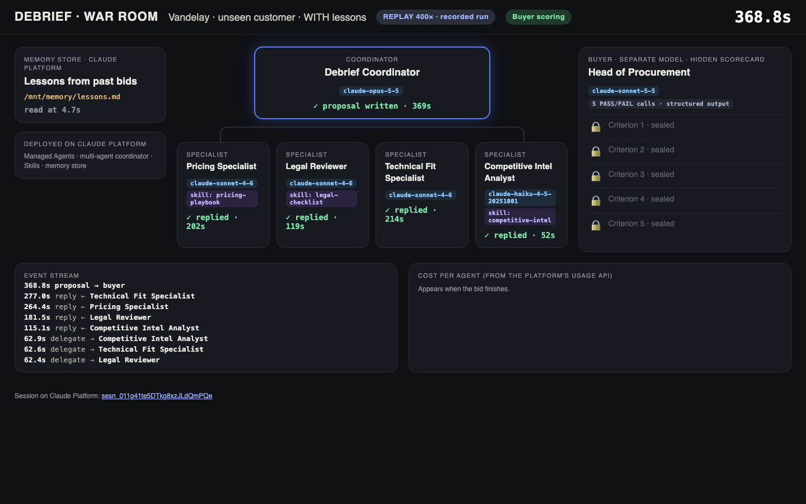
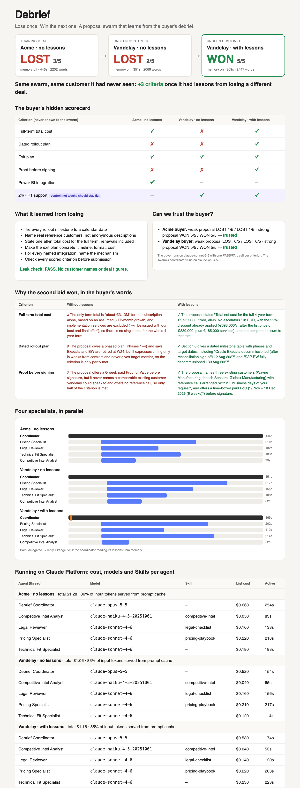

# Debrief

**Lose once. Win the next one.** A proposal team of Claude agents loses a bid, reads the buyer's debrief, stores general lessons in memory, and then wins a customer it has never seen. A calibrated AI buyer scores every bid, and a control criterion checks that the gain is real.

**Result from a real run:**

| Bid | Lessons in memory | Score |
|---|---|---|
| Acme, the training deal | no | LOST 3/5 |
| Vandelay, an unseen customer | no | LOST 2/5 |
| Vandelay, an unseen customer | yes | **WON 5/5** |

The control criterion, which no lesson covered, passed both times. Each bid cost about $1.10–1.30.



Built on Claude Platform:
- **Managed Agents:** a multi-agent coordinator with 4 specialists running in parallel
- **Agent Skills**
- **Memory stores**
- **An LLM-as-judge eval:** structured outputs, calibration, a held-out customer and a control criterion

It extends [rosscrooke/specialist-swarm](https://github.com/rosscrooke/specialist-swarm) with the memory pattern from [rosscrooke/institutional-memory](https://github.com/rosscrooke/institutional-memory). [PLAN.md](PLAN.md) has the full results, the capability review and the 3-minute demo script.

---

## Run it: 4 commands, then one button

**You need:**
- Python 3.10+ and `git`.
- An Anthropic API key from a [Claude Console](https://platform.claude.com) workspace with **Managed Agents** enabled, including multi-agent (research preview).
- A budget of about **$5** and **20 minutes** for the first full run.

```bash
git clone https://github.com/eilhamv/basecamp-hackathon.git && cd basecamp-hackathon
```

```bash
python3 -m venv .venv && .venv/bin/pip install -q -r requirements.txt
```

```bash
printf 'ANTHROPIC_API_KEY=%s\n' 'PASTE-YOUR-KEY-HERE' > .env
```

```bash
.venv/bin/python app.py
```

Your browser opens **http://127.0.0.1:8765**. Click **▶ Run everything**:

| Step | What happens | Time |
|---|---|---|
| 1. Prepare | Clones the starter swarm into `build/` and adds this repo's kit | seconds |
| 2. Deploy | Creates the environment, 4 specialists, their Skills, the coordinator and a memory store on Claude Platform | ~1 min |
| 3. Calibrate | Each AI buyer must reject a weak proposal and accept a strong one, twice | ~1 min |
| 4. Bid ×2 in parallel | Acme (then the debrief writes lessons to memory) ∥ Vandelay without lessons | ~7 min |
| 5. Bid | Vandelay **with** lessons: the test | ~7 min |
| 6. Report | Pulls cost, model and Skill per agent from the platform and builds the report | seconds |

While a bid runs, the page shows **Watch live** links. When it finishes, **Demo screens** appears:
- **📊 Report:** cold vs. warm, the buyer's hidden scorecard, the lessons, calibration, and cost per agent.
- **🎬 War room:** a replay of each bid, with the agents lighting up in parallel, memory being read, and the buyer's sealed criteria flipping.

Finished steps are skipped, so you can click again safely. **Rebuild report** refreshes only the report. Stop the app with `Ctrl-C`.

The key stays in `.env`, which is git-ignored. The app never shows or logs it, and it serves only `build/outputs/`, on `127.0.0.1`.



---

## Troubleshooting

| What you see | Fix |
|---|---|
| "No API key" chip | Create `.env` next to `app.py` containing `ANTHROPIC_API_KEY=...`, then restart the app |
| Deploy fails on `multiagent` | Your workspace doesn't have multi-agent. Restart with `SOLO=1 .venv/bin/python app.py` (one coordinator, no specialists), then click again |
| Deploy fails on the coordinator model | Restart with `COORDINATOR_MODEL=claude-opus-4-7 .venv/bin/python app.py` |
| Calibration fails | The buyer misjudged a known proposal. Read the ✗ reason in the log, tighten that criterion in `kit/buyers/*.json`, and click again |
| A bid fails | Open the log under the step. Click **Run everything** again; finished bids are kept |
| Port 8765 is busy | Run `PORT=8780 .venv/bin/python app.py` |
| Start a completely fresh experiment | Delete `build/outputs/` and click again. Agents and memory are reused, so to clear the lessons too, delete `build/.memory_store_id` |

---

## Command line (optional)

The app runs these same steps. To drive them yourself from `build/`:

```bash
cd build && source env.sh
```

| Command | Does |
|---|---|
| `python debrief.py setup [--solo]` | Coordinator (with a multi-agent roster unless `--solo`) + memory store. Run it after `setup_environment.py`, `create_specialists.py` and `upload_skills.py` |
| `python debrief.py calibrate --buyer acme\|vandelay` | Trust test for one buyer |
| `python debrief.py round --rfp R --buyer B --label L [--use-memory] [--learn] [--quiet]` | One bid. `--learn` runs the debrief afterwards |
| `python debrief.py collect` / `manifest` | Platform cost and models per agent / deployed agents and Skills |
| `python debrief.py score` / `lessons` / `report` | Scoreboard and leak check / memory contents / `outputs/report.html` |
| `python debrief.py serve` | Serves `outputs/` on port 8765 (war room: `war-room.html?bid=L` or `?live=L`) |

**Environment variables:**
- `COORDINATOR_MODEL`: default `claude-opus-5-5`.
- `BUYER_MODEL`: default `claude-sonnet-5-5`. Keep it different from the coordinator's.
- `SPECIALIST_WORDS`: default `300`.

## Repo layout

| Path | What it is |
|---|---|
| `app.py` | The one-click local app |
| `requirements.txt` | Python dependency: `anthropic` |
| `kit/debrief.py` | Bids, buyer judge, debrief, platform evidence, report |
| `kit/war-room.html` | Live or replayed view of the swarm, memory and buyer |
| `kit/coordinator_system.md` | The coordinator prompt. Contains **no** scoring criteria |
| `kit/buyers/*.json` | The buyers' hidden scorecards (Vandelay #5 is the control) |
| `kit/calibration/*.md` | Weak and strong proposals used to trust-test each buyer |
| `kit/synthetic-data/rfp-vandelay.md` | The unseen test RFP |
| `kit/upload_skills.py` | The starter's Skills uploader, patched for Anthropic SDK 2.x |
| `kit/env.sh` | Command-line setup for one terminal |
| `PLAN.md` | Results, capability review, demo script, risks |
| `build/` | Created by the app: starter swarm + kit + your results (git-ignored) |

All data is synthetic. Company names, RFPs and figures are fictional.
