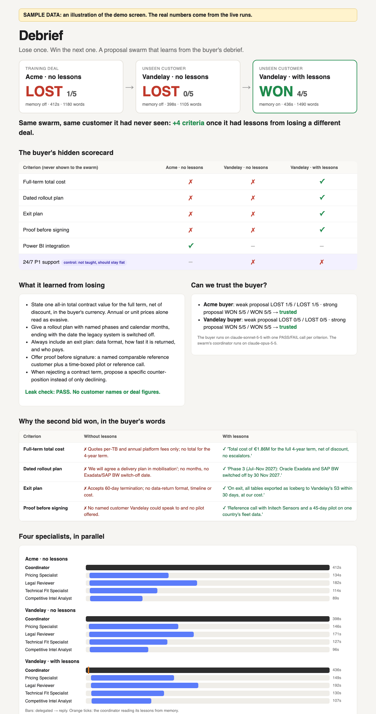

# Debrief

**Lose once. Win the next one.** A proposal team of Claude agents loses a bid, reads the buyer's debrief, stores general lessons in memory, and then wins a customer it has never seen. A calibrated AI buyer scores every bid, and a control criterion checks that the gain is real.



Built on Claude Platform:
- **Managed Agents:** a multi-agent coordinator with 4 specialists running in parallel
- **Agent Skills**
- **Memory stores**
- **An LLM-as-judge eval:** structured outputs, calibration, a held-out customer and a control criterion

It extends [rosscrooke/specialist-swarm](https://github.com/rosscrooke/specialist-swarm) with the memory pattern from [rosscrooke/institutional-memory](https://github.com/rosscrooke/institutional-memory).
- [PLAN.md](PLAN.md): results, the capability review, and the 5-screen demo script.
- This page: how to run it yourself.

---

## What you need

| | |
|---|---|
| Python | 3.10 or newer, plus `git` |
| API key | From a [Claude Console](https://platform.claude.com) workspace with **Managed Agents** enabled. **Multi-agent** (research preview) is needed for the parallel swarm; without it, use `--solo` in step 4 |
| Models | `claude-opus-5-5` (coordinator), `claude-sonnet-5-5` (buyer). The specialists use the starter's `claude-sonnet-4-6` and `claude-haiku-4-5`. You can override with `COORDINATOR_MODEL` and `BUYER_MODEL` |
| Budget | About **$5** at list price for one full run: about $1–1.30 per bid × 3, plus a debrief and about 55 judge calls |
| Time | About **30 minutes**. Each bid takes 6–8 minutes, and two of them run in parallel |

The key goes in a git-ignored `.env` file. Never commit it or paste it anywhere else.

---

## Run it

All commands are for macOS or Linux, in a terminal.

### 1. Get the code

```bash
git clone https://github.com/eilhamv/basecamp-hackathon.git && cd basecamp-hackathon
```

```bash
git clone https://github.com/rosscrooke/specialist-swarm.git build
```

```bash
cp -R kit/* build/ && cd build
```

`build/` holds the starter swarm plus this repo's kit, and it's git-ignored. **Every command from here on runs inside `build/`.** The kit replaces the starter's `upload_skills.py` with a version patched for Anthropic SDK 2.x.

### 2. Install

```bash
python3 -m venv .venv && .venv/bin/pip install -q -r requirements.txt && .venv/bin/pip install -q -U anthropic
```

### 3. Add your key and load it

```bash
printf 'ANTHROPIC_API_KEY=%s\n' 'PASTE-YOUR-KEY-HERE' > .env
```

```bash
source env.sh
```

`env.sh` activates the virtual environment, loads `.env`, and unsets `ANTHROPIC_BASE_URL` so calls go to the Claude API rather than a proxy. **Run `source env.sh` in every new terminal,** from inside `build/`. It should print `workspace key loaded`.

### 4. Deploy the agents to Claude Platform

```bash
python setup_environment.py && python create_specialists.py && python upload_skills.py && python debrief.py setup
```

Expected output: 4 specialists created, 3 Skills attached, then `Coordinator (swarm, claude-opus-5-5)` and `Memory store: …`.

| If it fails on… | Do this |
|---|---|
| `multiagent` | `python debrief.py setup --solo` (one coordinator, no specialists) |
| the coordinator model | `export COORDINATOR_MODEL=claude-opus-4-7`, then `python debrief.py setup` |
| the memory store | Add `--backend local` to every later `round`, `score` and `lessons` command |

### 5. Calibrate the AI buyers (never skip)

```bash
python debrief.py calibrate --buyer acme && python debrief.py calibrate --buyer vandelay
```

You need `CALIBRATION PASSED` twice. That means each buyer rejected a weak proposal and accepted a strong one, with the same result twice. Without this, the scores mean nothing.

### 6. Run the experiment

**Two terminals at once** (run `source env.sh` in each):

```bash
python debrief.py round --rfp acme --buyer acme --label acme-cold --learn --quiet
```

```bash
python debrief.py round --rfp vandelay --buyer vandelay --label vandelay-cold --quiet
```

- **The first** is the training deal. It bids on Acme, gets scored, then writes general lessons to memory. It ends with `=== LESSONS NOW IN MEMORY ===`.
- **The second** is the baseline: the unseen customer, with no lessons.

**When both have finished,** run the test, which is the same unseen customer with the lessons:

```bash
python debrief.py round --rfp vandelay --buyer vandelay --label vandelay-warm --use-memory --quiet
```

A `[memory read] /mnt/memory/…` line should appear before the specialists are spawned.

### 7. See the result

```bash
python debrief.py collect && python debrief.py manifest && python debrief.py score
```

`score` prints the comparison, the control and the leak check:
```
UNSEEN CUSTOMER: cold 2/5 -> warm ?/5 (+?)
CONTROL (criterion 5, not taught): cold PASS / warm PASS -> flat, as expected
LEAK CHECK on lessons: PASS (general lessons only)
```

### 8. Open the demo screens

```bash
python debrief.py report && python debrief.py serve
```

Then open:

| Screen | URL |
|---|---|
| War room, replay of a recorded bid | http://127.0.0.1:8765/war-room.html?bid=acme-cold&speed=15 |
| War room, the winning bid | http://127.0.0.1:8765/war-room.html?bid=vandelay-warm&speed=15 |
| War room, a bid running right now | http://127.0.0.1:8765/war-room.html?live=LABEL |
| Report: the proof | http://127.0.0.1:8765/report.html |

`serve` binds to `127.0.0.1` only. The 3-minute run of show is in [PLAN.md §3](PLAN.md).

---

## Commands

| Command | Does |
|---|---|
| `debrief.py setup [--solo]` | Creates the coordinator (with a multi-agent roster unless `--solo`) and the memory store |
| `debrief.py calibrate --buyer B` | Scores a weak and a strong proposal twice each. Writes `outputs/calibration-B.json` |
| `debrief.py round --rfp R --buyer B --label L [--use-memory] [--learn] [--quiet]` | One bid. Writes `outputs/L.md`, `L.verdict.json` and `L.live.json`. `--learn` also runs the debrief |
| `debrief.py collect [--label L]` | Adds platform cost, cache use, model and Skill per agent to saved verdicts |
| `debrief.py manifest` | Writes `outputs/deployment.json`: agents, models and Skills as deployed |
| `debrief.py score` / `lessons` | Terminal scoreboard and leak check / what the swarm remembered |
| `debrief.py report [--banner TEXT]` | Writes `outputs/report.html`. Works offline |
| `debrief.py serve [--port 8765]` | Serves `outputs/` for the war room and report |

**Environment variables:**
- `COORDINATOR_MODEL`: default `claude-opus-5-5`.
- `BUYER_MODEL`: default `claude-sonnet-5-5`. Keep it different from the coordinator's.
- `SPECIALIST_WORDS`: default `300`; lower it to speed bids up.

## Repo layout

| Path | What it is |
|---|---|
| `kit/debrief.py` | The CLI: bids, buyer judge, debrief, evidence, report, server |
| `kit/war-room.html` | Live or replayed view of the swarm, memory and buyer |
| `kit/coordinator_system.md` | The coordinator prompt. Contains **no** scoring criteria |
| `kit/buyers/*.json` | The buyers' hidden scorecards (Vandelay #5 is the control) |
| `kit/calibration/*.md` | Weak and strong proposals used to trust-test each buyer |
| `kit/synthetic-data/rfp-vandelay.md` | The unseen test RFP (fictional) |
| `kit/upload_skills.py` | The starter's Skills uploader, patched for Anthropic SDK 2.x |
| `kit/env.sh` | Per-terminal setup: venv, key and API routing |
| `PLAN.md` | Results, capability review, demo script, risks |

## Troubleshooting

| Symptom | Fix |
|---|---|
| `Set ANTHROPIC_API_KEY first` | You're not in `build/`, or you didn't run `source env.sh` in this terminal |
| `WARNING: ANTHROPIC_BASE_URL is set` | Run `source env.sh` again; it unsets it |
| `'BetaSkill' object has no attribute 'display_title'` | You're running the starter's `upload_skills.py`. Repeat `cp -R kit/* build/` |
| `Missing .coordinator_id` | Run step 4 first |
| The war room is blank | Open it through `debrief.py serve`, not as a file, and check that `outputs/<label>.verdict.json` exists |
| Costs look 100× too high | You're on an old `debrief.py`. Platform amounts are in cents; the current kit converts them |

All data in this repo is synthetic. Company names, RFPs and figures are fictional.
